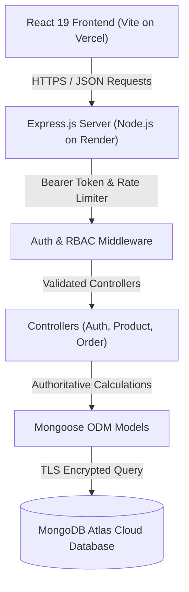

# SkillNexis — Week 4: Capstone Project (Full-Stack MERN E-Commerce Platform)

> **Application Name:** NexisStore  
> **Candidate:** Suryansh Singh  
> **Role:** Full Stack Developer  
> **Location:** Lucknow, Uttar Pradesh, India  
> **GitHub Profile:** [https://github.com/suryanshSingh07](https://github.com/suryanshSingh07)  
> **Portfolio:** [https://suryanshsingh.vercel.app](https://suryanshsingh.vercel.app)  
> **Email:** [suryanshsinghchauhanthakur@gmail.com](mailto:suryanshsinghchauhanthakur@gmail.com) | **Phone:** +91-8874518917  
> **Live Web Application (Vercel):** [https://skillnexis-full-stack-web-dev.vercel.app](https://skillnexis-full-stack-web-dev.vercel.app) *(or your deployed Vercel domain)*  
> **API Server (Render):** [https://nexisstore-api.onrender.com](https://nexisstore-api.onrender.com) *(or your deployed Render service)*  

---

## 1. Project Title & Executive Overview

**NexisStore** is a full-stack, production-grade e-commerce web application developed as the **Capstone Project** for the **SkillNexis Full Stack Web Development Internship (Week 4)**.

Built on the modern **MERN stack** (React 19, Node.js, Express.js, MongoDB Atlas), NexisStore delivers a complete shopping experience: from responsive storefront browsing and category filtering to bank-grade JWT authentication, client/server input validation, authoritative database-backed shopping cart calculations, stock decrementing, and a full-featured Administrator control panel for inventory and order fulfillment management.

---

## 2. Internship & Assignment Context

The Week 4 Capstone brings together all foundations acquired across the 4-week internship curriculum:
* **Week 1:** Semantic HTML5, accessible CSS3 design systems, responsive UI components, Flexbox/Grid layouts.
* **Week 2:** React state management, React Router navigation, Node.js REST API creation, Mongoose data modeling, bcrypt password encryption, and JWT token issuance.
* **Week 3:** Full-stack integration, Context API state synchronization, protected routes, Axios service layers with request interceptors, Multer file handling, and cross-user data isolation.
* **Week 4 (Capstone):** Production architecture, authoritative order checkout calculations, administrator RBAC authorization, automated testing with Jest and Supertest, containerized deployment strategy (MongoDB Atlas, Render backend, Vercel frontend), and zero-secret GitHub hygiene.

---

## 3. Problem Statement & Engineering Objectives

### The Problem
Traditional starter or tutorial-style e-commerce projects suffer from critical flaws:
1. **Client-Trusted Pricing:** Calculating order subtotals and totals in browser code, leaving systems vulnerable to client-side payload tampering.
2. **Race Conditions & Phantom Stock:** Allowing customers to purchase items that are already out of stock without atomic validation.
3. **Weak Access Controls:** Lacking strict role-based separation between public visitors, logged-in customers, and store administrators.
4. **Poor Resiliency & Deployment Blindspots:** Failing to account for free-tier hosting cold starts, CORS domain whitelisting, and SPA routing rewrites.

### The Objectives
* **Authoritative Server Pricing:** The backend verifies each product against MongoDB, calculates prices, delivery tiers, and taxes independently, and guarantees that frontend totals cannot be spoofed.
* **Safe Stock Depletion:** Stock is decremented at order creation and safely restored if an order is cancelled.
* **Enterprise Security:** Passwords hashed with bcrypt (10 rounds); tokens signed with cryptographic JWT secrets; Express protected with Helmet HTTP headers and IP rate limiting.
* **Modern High-Performance UX:** Mobile-first layout with curated dark glassmorphism, instant search filtering, accessible inputs, and toast feedback.

---

## 4. Key Features

### A. Customer Storefront & Catalog
* **Dynamic Home Page:** Hero banner, value propositions (free shipping, 14-day returns), featured collections, and category cards.
* **Full Product Catalog (`/products`):** Real-time text search, category filtering (Electronics, Fashion, Home, Accessories), price & rating sorting, and product count indicators.
* **Product Details View (`/products/:id`):** Multi-resolution images, brand details, stock status badges (`In Stock`, `Low Stock`, `Out of Stock`), quantity stepper, and related products carousel.

### B. Authentication & Security
* **User Registration & Login:** Email format validation, password length checks, duplicate email prevention with `409 Conflict`.
* **JWT Authentication:** Tokens stored securely in `localStorage` and dispatched via Axios `Bearer` authorization headers.
* **Role-Based Access Control (RBAC):** Distinct permissions for `user` and `admin` roles, enforced via Express middleware and React route guards (`<ProtectedRoute>` and `<AdminRoute>`).
* **Rate Limiting:** Protects `/api/auth` from credential-stuffing attacks (30 attempts per 15-minute window).

### C. Persistent Shopping Cart & Authoritative Checkout
* **Cart Persistence:** Automatically synchronized with `localStorage` across refreshes.
* **Quantity Bounds:** Prevents selecting quantities higher than actual inventory.
* **Authoritative Checkout:** Subtotal, ₹99 flat delivery (free on orders ≥ ₹999), and 5% GST calculated on the server.
* **Dual Payment Methods:** Simulated Instant Payment (`demo_card`) and Cash on Delivery (`cod`).

### D. Order Tracking & Customer History
* **Celebratory Receipt Page (`/order-success/:id`):** Instant confirmation with order ID, delivery destination, and price breakdown.
* **My Orders Page (`/orders`):** Complete chronological purchase history with live fulfillment statuses (`processing`, `shipped`, `delivered`, `cancelled`).
* **Ownership Isolation:** Regular users can only access their own orders; unauthorized attempts return `403 Forbidden`.

### E. Administrator Portal (`/admin`)
* **Executive Metrics Dashboard:** Real-time revenue statistics, total orders, pending fulfillments, and product counts.
* **Inventory Management:** Product table with thumbnail previews, stock indicators, and instant edit/delete triggers.
* **Product CRUD (`/admin/products/new`, `/admin/products/:id/edit`):** Full form with live image preview and category assignments.
* **Order Logistics Management:** Real-time status update dropdowns (`processing` -> `shipped` -> `delivered` -> `cancelled`). Cancelling an order automatically restores item quantities to inventory!

---

## 5. Technology Stack

| Layer | Technologies Used |
| :--- | :--- |
| **Frontend** | React 19, Vite 6, React Router DOM v6, Axios, Lucide React icons |
| **Styling** | Vanilla CSS3 (Custom Properties, Glassmorphism, Responsive Grid/Flexbox) |
| **Backend** | Node.js (v18+ / v20+), Express.js 4.21, Mongoose ODM 8.10 |
| **Security & Auth** | JSON Web Tokens (`jsonwebtoken`), `bcryptjs`, `helmet`, `express-rate-limit`, `cors` |
| **Database** | MongoDB Atlas (Cloud Multi-Region Cluster) / Local MongoDB |
| **Testing** | Jest 29, Supertest 7 |
| **Deployment** | Vercel (Frontend SPA), Render (Backend Web Service), MongoDB Atlas (Database) |

---

## 6. Application Architecture



---

## 7. Repository & Folder Structure

```text
week-4/
├── README.md                                  # Complete Week 4 Capstone documentation
├── client/                                    # Frontend React 19 application (Vite)
│   ├── package.json                           # Dependencies: react, react-router-dom, axios, lucide-react
│   ├── vite.config.js                         # Development port 5173 + API proxy configuration
│   ├── vercel.json                            # Single Page Application (SPA) rewrite rules
│   ├── index.html                             # Semantic HTML5 entry with Google Fonts
│   ├── .env.example                           # Frontend environment variables template
│   └── src/
│       ├── main.jsx                           # Application entrypoint
│       ├── App.jsx                            # Route definitions & Context Providers
│       ├── index.css                          # Complete design system & custom CSS properties
│       ├── components/                        # Reusable UI components
│       │   ├── Navbar.jsx                     # Responsive navigation with badge & profile dropdown
│       │   ├── Footer.jsx                     # Footer with category navigation & value banners
│       │   ├── ProductCard.jsx                # Interactive product card with stock badges
│       │   ├── ProductGrid.jsx                # Responsive grid container with empty state
│       │   ├── CartItem.jsx                   # Cart item stepper with quantity bounds
│       │   ├── FilterSidebar.jsx              # Category filter & price/rating sorter
│       │   ├── LoadingSpinner.jsx             # Accessible CSS animated loader
│       │   ├── ToastNotification.jsx          # Live alert toast provider
│       │   ├── ConfirmationModal.jsx          # Reusable action confirmation modal
│       │   ├── ProtectedRoute.jsx             # Customer authentication route guard
│       │   └── AdminRoute.jsx                 # Role-based Administrator route guard
│       ├── pages/                             # Application view pages
│       │   ├── HomePage.jsx                   # Hero, value banners, featured collections
│       │   ├── ProductsPage.jsx               # Search, filter, and catalog grid
│       │   ├── ProductDetailsPage.jsx         # Product imagery, specs, stock, and add-to-cart
│       │   ├── CartPage.jsx                   # Cart list, summary card, checkout CTA
│       │   ├── LoginPage.jsx                  # Login form with one-click demo credentials
│       │   ├── SignupPage.jsx                 # User registration with client-side checks
│       │   ├── CheckoutPage.jsx               # Shipping address & payment selection
│       │   ├── OrderSuccessPage.jsx           # Order confirmation & receipt overview
│       │   ├── OrdersPage.jsx                 # Customer order history & status tracking
│       │   ├── ProfilePage.jsx                # Profile information & address editor
│       │   ├── AdminDashboardPage.jsx         # Admin metrics, inventory CRUD, order logistics
│       │   ├── ProductFormPage.jsx            # Create / Edit product form with live image preview
│       │   └── NotFoundPage.jsx               # 404 error page with recovery navigation
│       ├── context/                           # State management
│       │   ├── AuthContext.jsx                # Global JWT auth, user session, login/logout
│       │   └── CartContext.jsx                # Shopping cart, item quantities, toast events
│       ├── services/                          # API communication
│       │   └── api.js                         # Axios instance with Bearer interceptors
│       └── utils/                             # Formatting helpers
│           └── formatters.js                  # formatPrice (INR), formatDate, getStockStatus
│
├── server/                                    # Backend Express.js REST API
│   ├── package.json                           # Scripts: start, dev, seed, test
│   ├── .env.example                           # Backend environment variables template
│   ├── src/
│   │   ├── app.js                             # Express setup, Helmet, CORS, Morgan, routes
│   │   ├── server.js                          # Database initialization & graceful shutdown
│   │   ├── config/
│   │   │   ├── db.js                          # Mongoose connection logic
│   │   │   └── seed.js                        # Database seed script for products & accounts
│   │   ├── models/
│   │   │   ├── User.js                        # User schema with bcrypt pre-save hashing
│   │   │   ├── Product.js                     # Product schema with stock & text indexes
│   │   │   └── Order.js                       # Order schema with embedded items & shipping
│   │   ├── middleware/
│   │   │   ├── auth.js                        # JWT verification & authorizeAdmin middleware
│   │   │   ├── rateLimiter.js                 # express-rate-limit security protection
│   │   │   ├── errorHandler.js                # Centralized error handler with Mongoose checks
│   │   │   └── notFound.js                    # 404 route handler
│   │   ├── validators/
│   │   │   ├── authValidator.js               # Registration & login body validation
│   │   │   ├── productValidator.js            # Product creation & update validation
│   │   │   └── orderValidator.js              # Order items & shipping address validation
│   │   ├── controllers/
│   │   │   ├── authController.js              # register, login, getProfile, updateProfile
│   │   │   ├── productController.js           # CRUD, featured, categories, pagination
│   │   │   └── orderController.js             # Authoritative checkout, user & admin orders
│   │   └── routes/
│   │       ├── authRoutes.js                  # /api/auth routes
│   │       ├── productRoutes.js               # /api/products routes
│   │       └── orderRoutes.js                 # /api/orders routes
│   └── tests/                                 # Automated integration test suites
│       ├── auth.test.js                       # 7 tests: registration, conflict, login, profile
│       ├── product.test.js                    # 6 tests: catalog, pagination, admin authorization
│       └── order.test.js                      # 5 tests: authoritative checkout, stock, ownership
│
├── postman/                                   # Postman workspace assets
│   ├── ecommerce-api-collection.json          # Complete 16-endpoint collection with test scripts
│   └── local.postman_environment.json         # Local environment variables configuration
│
└── screenshots/                               # Visual documentation
    └── README.md                              # Screenshot catalog and UI guides
```

---

## 8. Database Schema Overview

### 1. User Model (`models/User.js`)
* `name`: String, required, min 2 chars.
* `email`: String, required, unique, lowercase, regex validated.
* `password`: String, required, min 6 chars, `select: false` (never returned in responses).
* `role`: String, enum: `['user', 'admin']`, default: `'user'`.
* `address`: Embedded subdocument (`street`, `city`, `state`, `postalCode`, `country`).
* **Pre-save Hook:** Hashes passwords with bcrypt (10 salt rounds) when modified.
* **Instance Method:** `matchPassword(enteredPassword)` compares plaintext against hashed bcrypt string.

### 2. Product Model (`models/Product.js`)
* `name`: String, required, trimmed.
* `description`: String, required.
* `price`: Number, required, non-negative.
* `category`: String, required, lowercase (e.g., `electronics`, `fashion`, `home`, `accessories`).
* `brand`: String, default: `'Nexis'`.
* `stock`: Number, required, whole integer ≥ 0.
* `imageUrl`: String, required, direct image URL.
* `rating`: Number, default 4.5.
* `numReviews`: Number, default 0.
* `isFeatured`: Boolean, default false.
* **Indexes:** Compound text index on `name`, `description`, and `category` for search queries.

### 3. Order Model (`models/Order.js`)
* `user`: ObjectId, ref `'User'`, required.
* `orderItems`: Array of embedded order item objects:
  * `product`: ObjectId, ref `'Product'`, required.
  * `name`: String, required.
  * `quantity`: Number, required, min 1.
  * `price`: Number, required (authoritative price recorded at checkout).
  * `imageUrl`: String, required.
* `shippingAddress`: Embedded subdocument (`fullName`, `street`, `city`, `state`, `postalCode`, `phone`, `country`).
* `paymentMethod`: String, enum: `['demo_card', 'cod']`, default: `'demo_card'`.
* `paymentStatus`: String, enum: `['pending', 'paid']`, default: `'paid'`.
* `orderStatus`: String, enum: `['pending', 'processing', 'shipped', 'delivered', 'cancelled']`, default: `'processing'`.
* `subtotal`: Number, required (sum of product price × quantity).
* `shippingPrice`: Number, required (₹0 if subtotal ≥ ₹999, else ₹99).
* `taxPrice`: Number, required (5% GST).
* `totalPrice`: Number, required (`subtotal + shippingPrice + taxPrice`).
* `paidAt`: Date.
* `deliveredAt`: Date.

---

## 9. API Endpoint Reference

| Method | Endpoint | Access Level | Description |
| :--- | :--- | :--- | :--- |
| `GET` | `/api/health` | **Public** | Health-check status, version, and uptime for Render monitoring |
| `POST` | `/api/auth/register` | **Public** | Register new customer account (Rate limited) |
| `POST` | `/api/auth/login` | **Public** | Authenticate user & return JWT token (Rate limited) |
| `GET` | `/api/auth/me` | **Private (User)** | Get currently authenticated profile |
| `PUT` | `/api/auth/profile` | **Private (User)** | Update full name, shipping address, or change password |
| `GET` | `/api/products` | **Public** | Fetch products with search, category, sort, and pagination |
| `GET` | `/api/products/featured` | **Public** | Fetch featured collections for homepage showcase |
| `GET` | `/api/products/categories` | **Public** | Get list of distinct product categories |
| `GET` | `/api/products/:id` | **Public** | Get single product specifications and details |
| `POST` | `/api/products` | **Private (Admin)** | Create a new product in the catalog |
| `PUT` | `/api/products/:id` | **Private (Admin)** | Update product pricing, specifications, or stock |
| `DELETE` | `/api/products/:id` | **Private (Admin)** | Permanently remove a product from inventory |
| `POST` | `/api/orders` | **Private (User)** | Authoritative checkout, price calculation, and stock decrement |
| `GET` | `/api/orders/myorders` | **Private (User)** | Retrieve authenticated user's own order history |
| `GET` | `/api/orders/:id` | **Private (Owner/Admin)** | Retrieve specific order receipt with ownership verification |
| `GET` | `/api/orders` | **Private (Admin)** | Retrieve all customer orders with executive analytics |
| `PUT` | `/api/orders/:id/status` | **Private (Admin)** | Update order status (`processing` -> `shipped` -> `delivered` -> `cancelled`) |

---

## 10. Local Installation & Setup Instructions

### Prerequisites
* **Node.js:** v18.0.0 or higher (v20+ LTS recommended)
* **npm:** v9.0.0 or higher
* **MongoDB:** Local MongoDB instance (`mongodb://localhost:27017/nexisstore`) or MongoDB Atlas URI

### Step 1: Clone & Navigate to Week 4
```bash
git clone https://github.com/suryanshSingh07/skillnexis-full-stack-web-dev.git
cd skillnexis-full-stack-web-dev/week-4
```

### Step 2: Configure Environment Variables

**Backend (`week-4/server/.env`):**
Create `week-4/server/.env` from the provided `.env.example`:
```env
PORT=5000
NODE_ENV=development
MONGODB_URI=mongodb://localhost:27017/nexisstore
JWT_SECRET=supersecret_jwt_key_nexisstore_week4_skillnexis
JWT_EXPIRES_IN=7d
CLIENT_URL=http://localhost:5173
```

**Frontend (`week-4/client/.env`):**
Create `week-4/client/.env` from the provided `.env.example`:
```env
VITE_API_BASE_URL=http://localhost:5000/api
```

### Step 3: Install Dependencies
```bash
# Install backend dependencies
cd server
npm install

# Install frontend dependencies
cd ../client
npm install
```

### Step 4: Seed Database with Initial Catalog & Accounts
Run the seed script from `week-4/server`:
```bash
cd ../server
npm run seed
```
This populates the database with 10 sample products across 4 categories and sets up the following initial accounts:
* **Admin Account:** `admin@nexisstore.com` | Password: `Admin@123456`
* **Demo Customer:** `suryansh@nexisstore.com` | Password: `User@123456`

### Step 5: Start the Development Servers
Open two terminal windows:

**Terminal 1 (Backend Server):**
```bash
cd week-4/server
npm run dev
# Server runs on http://localhost:5000
```

**Terminal 2 (Frontend Client):**
```bash
cd week-4/client
npm run dev
# Frontend runs on http://localhost:5173
```

Open `http://localhost:5173` in your browser.

---

## 11. Automated Testing Suite

The backend includes comprehensive automated integration tests written with **Jest** and **Supertest**. Tests run against in-memory mocks, requiring no active database connection.

To run tests:
```bash
cd week-4/server
npm test
```

### Test Coverage Highlights
* **Authentication Suite (`auth.test.js`):**
  * `POST /api/auth/register` creates a new user, hashes password, and returns a JWT.
  * Rejects duplicate email registrations with `409 Conflict`.
  * Rejects invalid or missing registration fields with `400 Bad Request`.
  * `POST /api/auth/login` verifies valid credentials and issues JWT.
  * Rejects invalid passwords and non-existent users with `401 Unauthorized`.
  * `GET /api/auth/me` enforces Bearer token presence.
* **Product Suite (`product.test.js`):**
  * `GET /api/products` returns paginated catalog.
  * `GET /api/products/:id` returns product details and handles 404 for missing items.
  * Rejects product mutations from unauthenticated requests with `401 Unauthorized`.
  * Rejects product mutations from non-admin users with `403 Forbidden`.
  * Allows authenticated administrators to create and delete products.
* **Order & Authoritative Checkout Suite (`order.test.js`):**
  * Rejects unauthenticated checkout with `401 Unauthorized`.
  * Detects insufficient stock and rejects with `400 Bad Request`.
  * Calculates authoritative subtotal, delivery fee, and taxes from the database.
  * Automatically decrements stock count in MongoDB.
  * Verifies cross-user order ownership isolation (User B cannot view User A's order, returning `403 Forbidden`).
  * Allows Administrator to inspect all orders.

---

## 12. Production Deployment Guide

### A. MongoDB Atlas Database
1. Create a free M0 cluster on [cloud.mongodb.com](https://cloud.mongodb.com).
2. Under **Database Access**, create a user with read/write privileges (e.g., `nexis_user`).
3. Under **Network Access**, add IP address `0.0.0.0/0` (Allow access from anywhere) to permit connections from Render's cloud servers.
4. Copy the connection URI string:
   `mongodb+srv://<username>:<password>@cluster0.mongodb.net/nexisstore?retryWrites=true&w=majority`
5. Seed the production database using your local machine by temporarily executing:
   `MONGODB_URI="mongodb+srv://..." npm run seed`

### B. Render Web Service (Backend)
1. Sign in to [render.com](https://render.com) and click **New + > Web Service**.
2. Connect your GitHub repository: `suryanshSingh07/skillnexis-full-stack-web-dev`.
3. Configure the service settings:
   * **Name:** `nexisstore-api`
   * **Root Directory:** `week-4/server`
   * **Environment:** `Node`
   * **Build Command:** `npm install`
   * **Start Command:** `node src/server.js`
4. Add the **Environment Variables**:
   * `PORT`: `5000` (or leave default, Render sets this dynamically)
   * `NODE_ENV`: `production`
   * `MONGODB_URI`: `mongodb+srv://<user>:<password>@cluster0.mongodb.net/nexisstore?retryWrites=true&w=majority`
   * `JWT_SECRET`: `your_secure_random_jwt_secret_key`
   * `JWT_EXPIRES_IN`: `7d`
   * `CLIENT_URL`: `https://your-frontend-deployment.vercel.app`
5. Deploy the service and verify that `GET https://nexisstore-api.onrender.com/api/health` returns `status: "healthy"`.

### C. Vercel (Frontend Client)
1. Sign in to [vercel.com](https://vercel.com) and click **Add New > Project**.
2. Import your GitHub repository: `suryanshSingh07/skillnexis-full-stack-web-dev`.
3. In project settings:
   * **Framework Preset:** `Vite`
   * **Root Directory:** Click edit and select `week-4/client`
   * **Build Command:** `vite build`
   * **Output Directory:** `dist`
4. Add the **Environment Variable**:
   * `VITE_API_BASE_URL`: `https://nexisstore-api.onrender.com/api`
5. Deploy. The included `week-4/client/vercel.json` automatically ensures that client-side page refreshes (e.g. `/products`, `/cart`, `/orders`) correctly resolve without 404 errors.

---

## 13. Security & GitHub Hygiene Checklist

* [x] **No Plaintext Passwords:** Passwords encrypted using bcrypt (10 rounds).
* [x] **No Hardcoded Secrets:** JWT secrets and database connection strings are loaded exclusively via `process.env`.
* [x] **Authoritative Calculations:** Subtotals, delivery fees, and tax calculations are computed server-side from database prices.
* [x] **Cross-User Data Isolation:** Users cannot read or manipulate another user's orders.
* [x] **CORS Whitelisting:** Cross-Origin requests restricted to the designated `CLIENT_URL`.
* [x] **Rate Limiting:** Protects sensitive authentication endpoints from automated brute-force attacks.
* [x] **Clean Git Diff:** `node_modules`, `dist`, `.env`, and temporary system files are strictly excluded via `.gitignore`.

---

## 14. Known Limitations & Future Enhancements

* **Real Payment Gateway Integration:** The current checkout implements a simulated card and Cash on Delivery (COD) flow. A future production release could integrate Stripe or Razorpay webhooks.
* **Email Dispatch:** Order confirmation emails can be wired via SendGrid or AWS SES.
* **Product Reviews UI:** Add customer star rating submission directly from the order history view.

---

## 15. Submission Deliverables Summary

| Artifact | Location |
| :--- | :--- |
| **Frontend Source** | [`week-4/client/`](./client/) |
| **Backend Source** | [`week-4/server/`](./server/) |
| **Postman Collection** | [`week-4/postman/ecommerce-api-collection.json`](./postman/ecommerce-api-collection.json) |
| **Postman Environment** | [`week-4/postman/local.postman_environment.json`](./postman/local.postman_environment.json) |
| **Visual Documentation** | [`week-4/screenshots/`](./screenshots/) |
| **Automated Tests** | [`week-4/server/tests/`](./server/tests/) |
| **GitHub Repository** | [https://github.com/suryanshSingh07/skillnexis-full-stack-web-dev](https://github.com/suryanshSingh07/skillnexis-full-stack-web-dev) |

